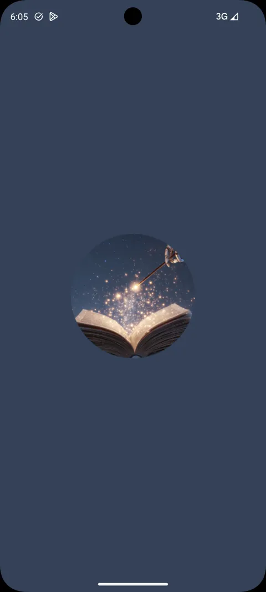
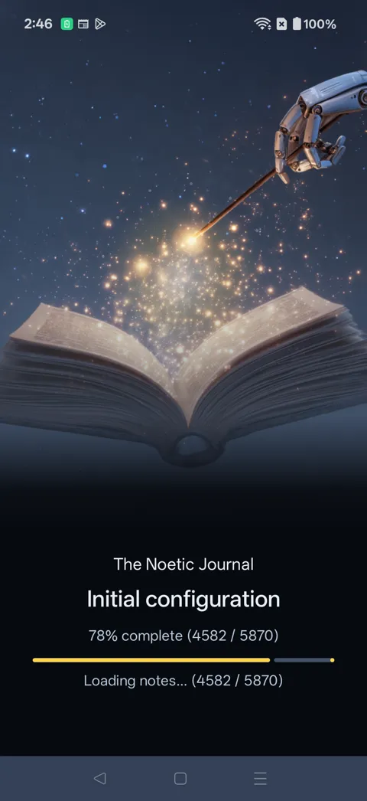

# Noetic Journal

A private, hierarchical knowledge workspace for Android. You organize notes into collections and workspaces, automate them with an embedded Lisp-style scripting language, and decide where AI runs: on your phone, on your own server, or with a cloud provider using your own key.

There are no accounts. Your journal lives on your device.

<a class="btn btn-primary" href="guide/index.html">Read the user guide</a>
<a class="btn btn-ghost" href="privacy.html">Privacy policy</a>

## First launch

<figure class="g-shot"><button type="button" data-full="../../assets/noetic-splash.webp" data-cap="Splash screen"></button><figcaption>Splash screen</figcaption></figure>
<figure class="g-shot"><button type="button" data-full="../../assets/noetic-loading.webp" data-cap="Initial configuration, loading a large journal"></button><figcaption>Initial configuration, loading a large journal</figcaption></figure>

## What it does

- **Notes in a tree:** collections, nested notes and switchable workspaces.
- **Your choice of AI:** on-device Gemma models with vision, self-hosted Ollama, or OpenAI, Anthropic and Gemini with your own API key.
- **Scripting:** a built-in Lisp REPL, macros, journal filters and scheduled commands.
- **Voice, camera and places:** on-device speech recognition, photos attached to notes, and location reminders.
- **Backup:** to your own Dropbox, as individual files or a ZIP.

The [user guide](guide/index.html) walks through each setup step. The [privacy policy](privacy.html) explains what stays on your phone and what each optional feature sends.
